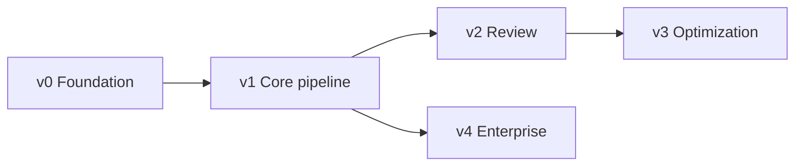
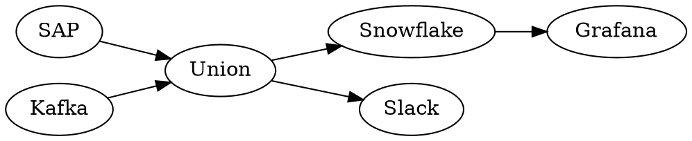

# Diagram Agent MCP

Generate architecture and data flow diagrams from natural language using AI, Graphviz and the Model Context Protocol (MCP).

Unlike traditional diagramming solutions, Diagram Agent MCP treats a semantic graph model as the source of truth. All visual artifacts are generated from this model and can be recreated at any time.

---

# Task Overview

Each phase lives in its own folder. Complete phases in order; tasks within v4 are independent of each other.



## v0 – Foundation

- [ ] [01 Project setup](v0-foundation/01-project-setup.md)
- [ ] [02 Semantic model schema](v0-foundation/02-semantic-model-schema.md)
- [ ] [03 Diagram storage layout](v0-foundation/03-diagram-storage-layout.md)

## v1 – Core pipeline

- [ ] [01 MCP server skeleton](v1-core/01-mcp-server-skeleton.md)
- [ ] [02 create_diagram](v1-core/02-create-diagram.md)
- [ ] [03 save_model](v1-core/03-save-model.md)
- [ ] [04 generate_graph](v1-core/04-generate-graph.md)
- [ ] [05 render_diagram](v1-core/05-render-diagram.md)
- [ ] [06 End-to-end dataflow example](v1-core/06-end-to-end-dataflow-example.md)

## v2 – Review

- [ ] [01 Review criteria](v2-review/01-review-criteria.md)
- [ ] [02 Layout metrics](v2-review/02-layout-metrics.md)
- [ ] [03 review_diagram](v2-review/03-review-diagram-tool.md)

## v3 – Optimization

- [ ] [01 Layout hints in model](v3-optimization/01-layout-hints-in-model.md)
- [ ] [02 improve_model](v3-optimization/02-improve-model.md)
- [ ] [03 optimize_diagram loop](v3-optimization/03-optimize-diagram-loop.md)

## v4 – Enterprise

- [ ] [01 Integration diagrams](v4-enterprise/01-integration-diagrams.md)
- [ ] [02 Architecture and trust boundaries](v4-enterprise/02-architecture-trust-boundaries.md)
- [ ] [03 Capability maps](v4-enterprise/03-capability-maps.md)
- [ ] [04 ROS diagrams](v4-enterprise/04-ros-diagrams.md)
- [ ] [05 Organization conventions](v4-enterprise/05-organization-conventions.md)

## Design decisions

- LLM work (natural language → model, visual review) is done by the MCP client (e.g. GitHub Copilot). The server validates, renders and computes metrics. MCP sampling may be added later.
- `diagram.json` is the only hand-edited artifact. DOT, SVG and PNG are always regenerated.


# Vision

Most diagram tools force users to think about rendering before meaning.

Typical workflow:

```text
Prompt
 ↓
Mermaid
 ↓
Layout fixes
 ↓
SVG
```

Diagram Agent MCP separates meaning from presentation.

```text
Prompt
 ↓
Semantic Graph Model (JSON)
 ↓
Git
 ↓
Graphviz
 ↓
SVG
 ↓
PNG
 ↓
Visual Review
 ↓
Model Improvements
 ↓
Approved Diagram
```

The graph model represents architectural intent.

Everything else is generated.

---

# Core Principles

## JSON Is The Source of Truth

Only the graph model should be edited.

```text
diagram.json
```

Generated artifacts:

```text
diagram.dot
diagram.svg
diagram.png
```

If all generated files are deleted, they should be reproducible from the JSON model.

---

## Separate Semantics From Rendering

Architecture:

```json
{
  "type": "dataflow",
  "sources": ["SAP", "Kafka"],
  "processors": ["Union"],
  "storage": ["Snowflake"],
  "consumers": ["Grafana", "Slack"]
}
```

Rendering:

```text
JSON
 ↓
Graph Builder
 ↓
DOT
 ↓
Graphviz
 ↓
SVG
```

Architecture knowledge belongs in the model.

Layout belongs in the renderer.

---

## Diagrams As Code

All diagrams are stored in Git.

```text
diagrams/
└── union-dataflow/
    ├── diagram.json
    ├── diagram.dot
    ├── diagram.svg
    └── diagram.png
```

The JSON model is reviewed and versioned.

SVG and PNG are disposable artifacts.

---

# Architecture

```text
┌──────────────────────┐
│ GitHub Copilot       │
└──────────┬───────────┘
           │
           ▼
┌──────────────────────┐
│ Diagram Agent MCP    │
└──────────┬───────────┘
           │
           ▼
┌──────────────────────┐
│ Semantic Model       │
│ diagram.json         │
└──────────┬───────────┘
           │
           ▼
┌──────────────────────┐
│ Graph Builder        │
└──────────┬───────────┘
           │
           ▼
┌──────────────────────┐
│ diagram.dot          │
└──────────┬───────────┘
           │
           ▼
┌──────────────────────┐
│ Graphviz             │
└──────────┬───────────┘
           │
     ┌─────┴─────┐
     ▼           ▼
diagram.svg  diagram.png
     │
     ▼
Visual Review
     │
     ▼
Model Updates
     │
     ▼
diagram.json
```

---

# Workflow

## Step 1 - Describe Architecture

Example:

```text
SAP and Kafka provide data to Union.
Union processes data and stores curated datasets in Snowflake.
Grafana consumes analytics data.
Slack receives operational alerts.
```

---

## Step 2 - Create Semantic Model

```json
{
  "type": "dataflow",
  "sources": [
    "SAP",
    "Kafka"
  ],
  "processors": [
    "Union"
  ],
  "storage": [
    "Snowflake"
  ],
  "consumers": [
    "Grafana",
    "Slack"
  ]
}
```

---

## Step 3 - Generate Graph

```text
diagram.json
 ↓
diagram.dot
```

Example:



---

## Step 4 - Render

```text
diagram.dot
 ↓
Graphviz
 ↓
diagram.svg
diagram.png
```

---

## Step 5 - Review

The generated PNG is analyzed.

Checks include:

- edge crossings
- overlapping labels
- excessive whitespace
- visual balance
- readability
- architecture conventions

Example:

```json
{
  "score": 7,
  "issues": [
    "Union should be visually centered",
    "Grafana overlaps Snowflake",
    "Consumers should be grouped"
  ]
}
```

---

## Step 6 - Improve Model

Important:

The review process updates the JSON model.

Not the SVG.

Not the PNG.

Not the DOT file.

Example:

```diff
{
  "processors": [
    {
      "name": "Union",
+     "importance": "primary"
    }
  ]
}
```

The diagram is then regenerated.

```text
Updated JSON
 ↓
DOT
 ↓
SVG
 ↓
PNG
 ↓
Review
```

---

# MCP Tools

## create_diagram

Creates a semantic graph model from natural language.

### Input

```text
Show the flow between SAP, Union and Snowflake.
```

### Output

```json
{
  "diagram_id": "union-dataflow",
  "model": {}
}
```

---

## save_model

Stores the semantic graph model.

### Output

```text
diagram.json
```

---

## generate_graph

Converts JSON into DOT.

### Input

```text
diagram.json
```

### Output

```text
diagram.dot
```

---

## render_diagram

Renders DOT into SVG and PNG.

### Output

```text
diagram.svg
diagram.png
```

---

## review_diagram

Analyzes the rendered PNG.

### Output

```json
{
  "score": 8,
  "issues": []
}
```

---

## improve_model

Applies suggested changes to the graph model.

### Input

```json
{
  "model": {},
  "review": {}
}
```

### Output

```json
{
  "updated_model": {}
}
```

---

## optimize_diagram

Runs the complete loop.

```text
Model
 ↓
Render
 ↓
Review
 ↓
Improve Model
 ↓
Render
 ↓
Review
```

Until:

```text
score >= threshold
```

---

# Supported Diagram Types

## Data Flow

Example:

```json
{
  "type": "dataflow"
}
```

Use cases:

- ETL pipelines
- Data products
- Event processing
- Batch workflows

---

## Integration Diagrams

Example:

```json
{
  "type": "integration"
}
```

Use cases:

- APIs
- Event brokers
- Enterprise integrations

---

## Capability Maps

Example:

```json
{
  "type": "capability"
}
```

Use cases:

- Product capabilities
- Platform capabilities
- Business capabilities

---

## Architecture Diagrams

Example:

```json
{
  "type": "architecture"
}
```

Use cases:

- Trust zones
- Platforms
- Applications
- Infrastructure

---

## ROS Diagrams

Example:

```json
{
  "type": "risk"
}
```

Use cases:

- Threat modeling
- Risk assessment
- Mitigation mapping

---

# Repository Layout

```text
diagrams/

├── dataflow/
│   └── union/
│       ├── diagram.json
│       ├── diagram.dot
│       ├── diagram.svg
│       └── diagram.png
│
├── architecture/
│   └── union/
│       ├── diagram.json
│       ├── diagram.dot
│       ├── diagram.svg
│       └── diagram.png
│
├── capability/
│   └── union/
│       ├── diagram.json
│       ├── diagram.dot
│       ├── diagram.svg
│       └── diagram.png
│
└── ros/
    └── union-risk/
        ├── diagram.json
        ├── diagram.dot
        ├── diagram.svg
        └── diagram.png
```

---

# Quality Guidelines

## Data Flow

- sources on the left
- processing in the center
- consumers on the right
- minimize edge crossings

## Architecture

- visible trust boundaries
- logical grouping
- clear primary flow

## Capability Maps

- balanced hierarchy
- readable grouping
- minimal clutter

## ROS

- clear causal chain
- readable consequences
- visible mitigations

---

# Roadmap

## Version 1

Core generation pipeline.

Features:

- create_diagram
- save_model
- generate_graph
- render_diagram

---

## Version 2

Diagram review.

Features:

- screenshot analysis
- quality score
- review feedback

---

## Version 3

Self-improving diagrams.

Features:

- improve_model
- optimization loop
- iterative rendering

---

## Version 4

Enterprise architecture support.

Features:

- capability maps
- ROS support
- trust boundaries
- organization-specific conventions

---

# Success Criteria

A user can describe an architecture in plain language and receive:

- a semantic graph model
- a version-controlled representation
- a generated Graphviz graph
- an SVG diagram
- a PNG preview
- an automatically reviewed and improved visualization

without manually creating Mermaid, DOT, SVG or Draw.io diagrams.